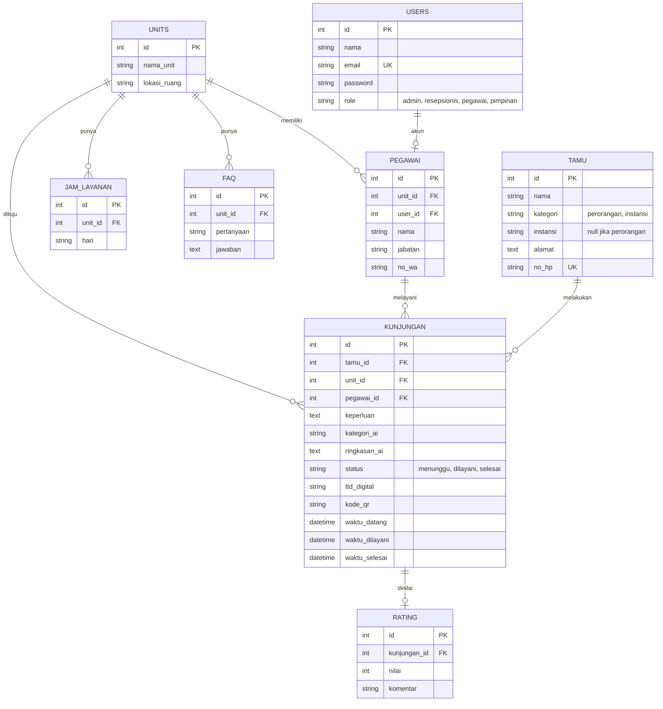
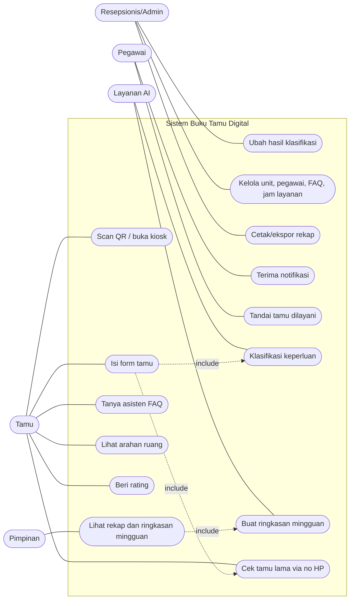
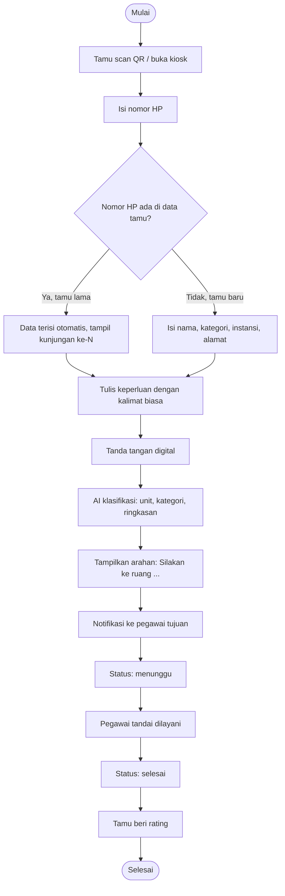
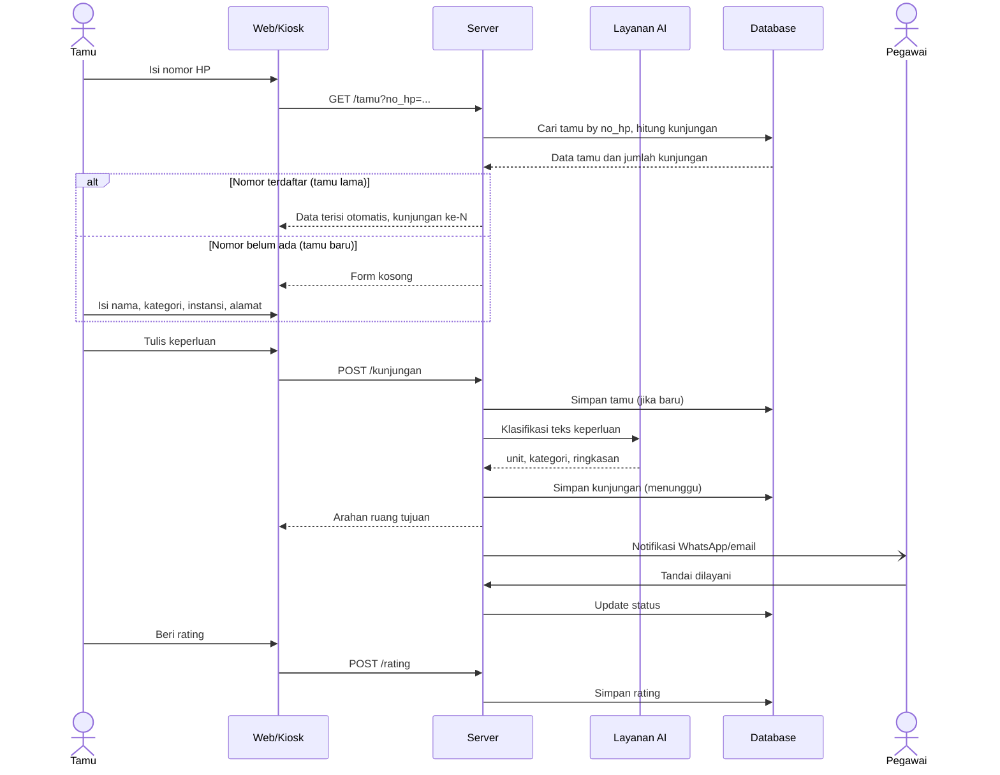
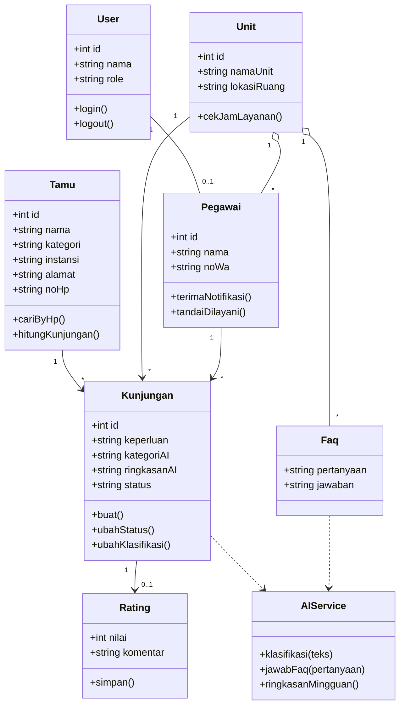

# Desain Sistem: Buku Tamu Digital

Buku tamu dengan asisten resepsionis (AI) · ERD, UML, dan wireframe

## 1. ERD (Entity Relationship Diagram)

8 tabel. Tamu lama dikenali lewat no_hp.

## 2. UML

### 2.1 Use Case Diagram

### 2.2 Activity Diagram (alur tamu)

### 2.3 Sequence Diagram (submit kunjungan)

### 2.4 Class Diagram

## 3. Wireframe

Kotak putus-putus = input. Tombol besar untuk mode kiosk.

#### 1 · Form tamu (kiosk/QR)

**Selamat Datang**

Nomor HP: 0812xxxx**CEK**

✔ Selamat datang kembali, Budi!\
Kunjungan ke-3 · data terisi otomatis

Nama: Budi

Kategori: ○ Perorangan ◉ Instansi

Instansi: Dinas X

Alamat: Jl. ...

Tulis keperluan Anda dengan kalimat biasa...

✍ Tanda tangan di sini

KIRIM

Nomor belum ada = tamu baru, isi data lengkap sekali saja.

#### 2 · Arahan setelah submit

**Terima kasih, Budi!**

Silakan ke\
**Ruang Pelayanan Data**\
Lantai 1

Keperluan: konsultasi data statistik.\
Petugas sudah diberi tahu.

💬 Tanya asisten: jam layanan, lokasi, syarat...

SELESAI

#### 3 · Dashboard resepsionis/pegawai

**3**Menunggu

**2**Dilayani

**14**Selesai

Budi · Dinas X tamu lama · ke-3\
Konsultasi data → Unit Datamenunggu ubah

Sari · CV Maju\
Antar surat → Umumdilayani

Andi · SMKN 1\
Magang → Kepegawaianselesai

Tandai dilayani

Hasil AI bisa diedit resepsionis.

#### 4 · Rekap pimpinan

Periode: Nov 2026Ekspor ▾ Cetak

**Kunjungan per unit**

Data

Umum

Kepegawaian

**Rata-rata rating: ★ 4,6**

**Ringkasan AI minggu ini**\
Keperluan terbanyak: konsultasi data dan pengantaran surat.