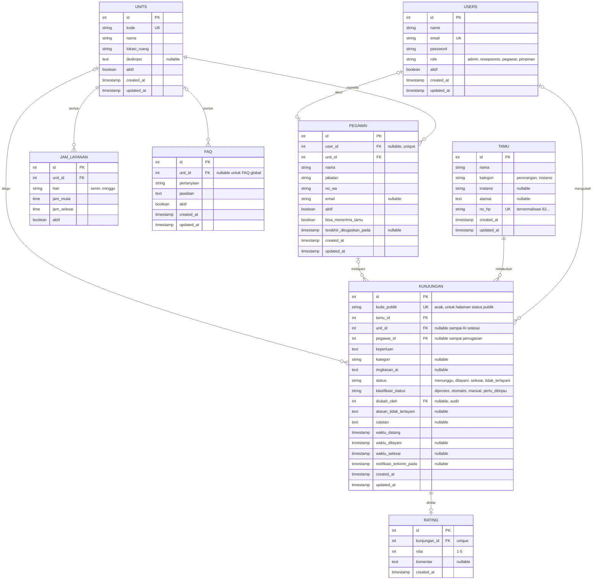
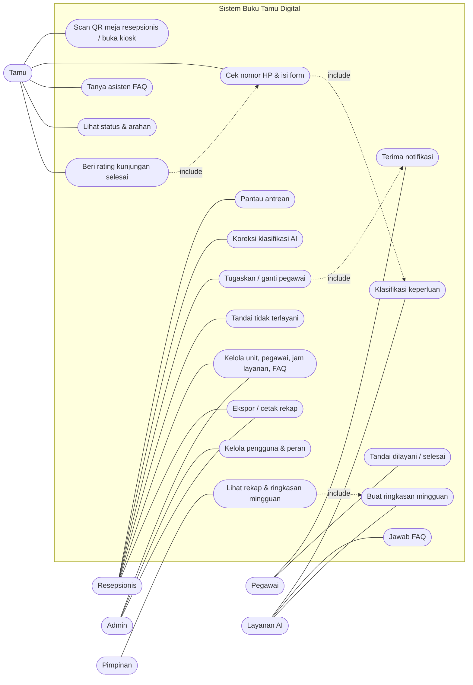
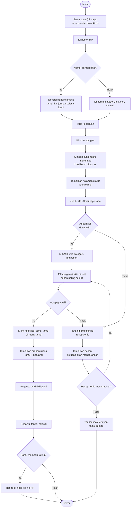
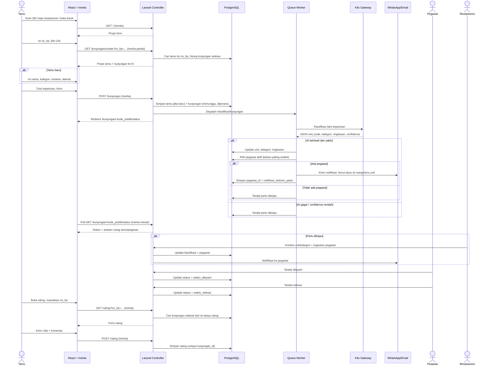
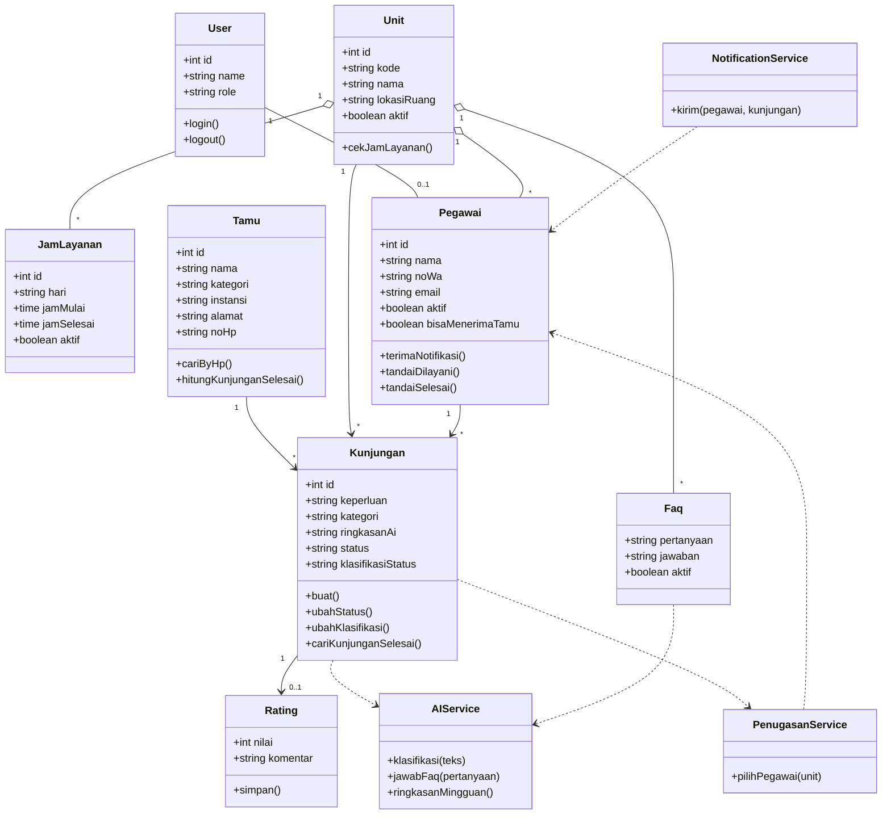

# Desain Sistem: Buku Tamu Digital

Buku tamu digital dengan asisten resepsionis (AI) · ERD, UML, wireframe, dan aturan bisnis.

> Dokumen ini adalah sumber kebenaran untuk **model data dan perilaku sistem**. Ringkasan produk, instalasi, dan operasional ada di [README.md](README.md).

## 0. Keputusan Desain

| No | Keputusan | Konsekuensi |
|---|---|---|
| 1 | QR hanya ada di **meja resepsionis**, bukan per meja/lokasi. | Tidak perlu tabel `lokasi_qr`; QR hanya membuka form. |
| 2 | Rating hanya untuk kunjungan berstatus **selesai**. | Kunjungan `tidak_terlayani` tidak bisa dinilai. |
| 3 | Rating dicari lewat **nomor HP**, tetapi unik per **kunjungan**. | Satu kunjungan hanya punya satu rating; tamu yang datang lagi tetap bisa menilai kunjungan berikutnya. |
| 4 | Tanda tangan digital **tidak dipakai di MVP**. | Tidak ada kolom tanda tangan. Bisa ditambahkan nanti sebagai fitur opsional. |
| 5 | Notifikasi dikirim ke **satu pegawai** yang ditugaskan. | Sistem memilih pegawai aktif di unit tujuan; resepsionis bisa mengganti. |
| 6 | Jika tetap tidak ada pegawai yang bisa melayani, kunjungan menjadi **tidak_terlayani** dan tamu pulang. | Resepsionis/admin mencoba mengganti pegawai lebih dulu; alasan dicatat. |
| 7 | Tamu lama boleh memperbarui identitas; **keperluan selalu per kunjungan**. | Tamu yang sama bisa datang dengan keperluan berbeda. |
| 8 | Endpoint memakai **Inertia**, bukan REST API terpisah. | Semua halaman React dirender lewat controller Laravel. |
| 9 | AI memakai **Kilo Gateway** dengan model gratis + fallback. | Model dicoba berurutan; jika semua gagal, kunjungan ditandai perlu ditinjau. |
| 10 | AI dan notifikasi dijalankan lewat **queue**. | Submit tetap cepat; halaman status melakukan polling sampai hasil AI siap. |
| 11 | Ringkasan mingguan **tidak disimpan di tabel**. | Dihitung saat halaman pimpinan dibuka dan di-cache sebentar; tidak perlu tabel laporan. |
| 12 | Tamu diarahkan ke **ruang tamu unit tujuan**; pegawai menemui tamu di sana. | Memakai `units.lokasi_ruang`; tidak perlu tabel ruang baru. |

## 1. ERD

**8 tabel.** Tamu lama dikenali lewat `no_hp` yang sudah dinormalisasi.



### Catatan ERD

- **Tanpa tanda tangan digital.** Kolom `ttd_digital`/`tanda_tangan` tidak ada.
- **Nomor HP** disimpan ternormalisasi (`08xx`, `+62xx`, `62xx` → `62xx`) dan diberi unique index.
- **`kunjungan.unit_id` dan `kunjungan.pegawai_id` nullable** karena AI dan penugasan berjalan lewat queue. Keduanya terisi setelah job selesai.
- **`rating.kunjungan_id` unique** untuk mencegah rating ganda pada kunjungan yang sama.
- **Ruang tamu** memakai `units.lokasi_ruang`. Tamu diarahkan ke ruang tamu unit tujuan, dan pegawai yang ditugaskan menemui tamu di sana.
- **Ringkasan mingguan tidak disimpan di tabel**; dihitung saat halaman pimpinan dibuka lalu di-cache sebentar.
- **`jam_layanan` berupa tabel**, bukan JSON, agar bisa beberapa baris per hari (misalnya 08.00–12.00 dan 13.00–16.00).
- **`klasifikasi_status`** memisahkan proses AI dari status kunjungan. Nilai `perlu_ditinjau` dipakai jika AI gagal, confidence rendah, atau tidak ada pegawai yang bisa ditugaskan.
- **`diubah_oleh` + `catatan`** menjadi jejak audit sederhana saat resepsionis mengoreksi klasifikasi atau menandai kunjungan.
- **`waktu_selesai`** diisi saat status menjadi `selesai` atau `tidak_terlayani` (akhir proses kunjungan).
- **`kode_publik`** adalah kode acak untuk halaman status tamu, agar ID berurutan tidak bisa ditebak.
- Gunakan `timestamptz` di PostgreSQL dan `APP_TIMEZONE=Asia/Jakarta`.

## 2. UML

### 2.1 Use Case Diagram



### 2.2 Activity Diagram (alur tamu)



### 2.3 Sequence Diagram (submit kunjungan, AI queue, rating)



### 2.4 Class Diagram



## 3. Wireframe

Kotak putus-putus = input. Tombol besar untuk mode kiosk. Tidak ada kolom tanda tangan.

#### 1 · Form tamu (kiosk/QR resepsionis)

**Selamat Datang**\
Meja Resepsionis

Nomor HP: 0812xxxx **[CEK]**

✔ Selamat datang kembali, Budi!\
Kunjungan selesai ke-3 · identitas terisi otomatis

Nama: Budi\
Kategori: ○ Perorangan ◉ Instansi\
Instansi: Dinas X\
Alamat: Jl. ...

Tulis keperluan Anda dengan kalimat biasa...\
_(keperluan selalu kosong untuk kunjungan baru)_

**[KIRIM]**

Nomor belum ada = tamu baru, isi identitas lengkap sekali saja.

#### 2 · Halaman status (setelah submit)

**Terima kasih, Budi!**

Keperluan Anda sedang diproses...\
⏳ Menunggu klasifikasi AI

Halaman ini diperbarui otomatis.\
Jika AI gagal atau tidak yakin, petugas resepsionis akan mengarahkan Anda.

#### 3 · Arahan setelah klasifikasi

**Silakan ke**\
**Ruang Tamu Unit Data**\
Lantai 1

Petugas: **Sari, S.Kom.** akan menemui Anda di ruang tamu.\
Keperluan: konsultasi data statistik.\
Petugas sudah diberi tahu via WhatsApp/email.

💬 Tanya asisten: jam layanan, lokasi, syarat...\
**[SELESAI]** · **[BERI RATING]**

#### 4 · Dashboard resepsionis/admin

**3** Menunggu · **2** Dilayani · **14** Selesai · **1** Tidak terlayani

Filter: Semua | Perlu ditinjau | Belum ada pegawai | Menunggu > 15 menit

Budi · Dinas X · tamu lama · kunjungan selesai ke-3\
Konsultasi data → Unit Data · **menunggu** · Pegawai: Sari\
[Koreksi klasifikasi] [Ganti pegawai] [Tandai tidak terlayani]

Sari · CV Maju\
Antar surat → Umum · **dilayani**

Andi · SMKN 1\
Magang → Kepegawaian · **selesai** · rating ★★★★☆

#### 5 · Dashboard pegawai

**Tugas Saya**

Budi · Dinas X\
Konsultasi data statistik · datang 09.14\
**[TANDAI DILAYANI]** **[TANDAI SELESAI]**

Jika tidak bisa melayani, hubungi resepsionis. Resepsionis akan mengganti pegawai atau menandai kunjungan tidak terlayani.

#### 6 · Rating tamu (kiosk)

**Beri Rating**

Masukkan nomor HP yang dipakai saat mendaftar:\
Nomor HP: 0812xxxx **[CARI]**

Kunjungan selesai hari ini:\
Budi · Unit Data · 09.14–09.40

Seberapa puas Anda? ☆ ☆ ☆ ☆ ☆\
Komentar (opsional): ...

**[KIRIM RATING]**

Hanya kunjungan berstatus **selesai** yang bisa dinilai. Satu kunjungan = satu rating.

#### 7 · Rekap pimpinan

Periode: Nov 2026 **[Ekspor ▾] [Cetak]**

**Kunjungan per unit**\
Data · Umum · Kepegawaian

**Rata-rata rating: ★ 4,6**\
**Tidak terlayani: 4 kunjungan**

**Ringkasan AI minggu ini**\
Keperluan terbanyak: konsultasi data dan pengantaran surat.\
Unit Data menerima kunjungan terbanyak pada Selasa–Kamis.

## 4. Aturan Bisnis

### 4.1 Status kunjungan

| Dari | Ke | Siapa | Syarat |
|---|---|---|---|
| `menunggu` | `dilayani` | Pegawai, resepsionis, admin | `pegawai_id` sudah terisi |
| `dilayani` | `selesai` | Pegawai, resepsionis, admin | — |
| `menunggu` | `tidak_terlayani` | Resepsionis, admin | `alasan_tidak_terlayani` wajib diisi |
| `dilayani` | `tidak_terlayani` | Resepsionis, admin | Layanan terhenti; alasan wajib diisi |

Tidak ada transisi balik. Jika terjadi kesalahan input, admin dapat mengoreksi lewat halaman detail (untuk MVP cukup ubah status secara terkontrol dan catat di `catatan`).

### 4.2 Penugasan pegawai

1. AI menentukan `unit_id`.
2. `PenugasanService` memilih **satu** pegawai dengan kriteria:
   - `unit_id` sama,
   - `aktif = true`,
   - `bisa_menerima_tamu = true`.
3. Urutan prioritas:
   - jumlah kunjungan aktif (`menunggu` + `dilayani`) paling sedikit,
   - `terakhir_ditugaskan_pada` paling lama,
   - `id` paling kecil sebagai penentu akhir.
4. Setelah dipilih, isi `pegawai_id`, perbarui `terakhir_ditugaskan_pada`, lalu kirim notifikasi.
5. Tamu diarahkan ke **ruang tamu unit tujuan** (`units.lokasi_ruang`). Pegawai yang ditugaskan menerima notifikasi untuk menemui tamu di ruang tersebut.
6. Jika tidak ada pegawai yang memenuhi syarat, `pegawai_id = null` dan kunjungan masuk daftar **perlu ditinjau**.
7. Resepsionis/admin dapat mengganti pegawai kapan saja sebelum status `selesai`. Pegawai baru langsung mendapat notifikasi.

### 4.3 Notifikasi dan tamu yang tidak terlayani

- Notifikasi dikirim ke **pegawai yang ditugaskan**, bukan ke semua pegawai unit.
- Kanal: WhatsApp (Fonnte untuk MVP, WhatsApp Cloud API untuk produksi) dan email sebagai cadangan.
- Jika pengiriman gagal, job di-retry. Dashboard tetap menampilkan antrean meskipun notifikasi gagal.
- Jika pegawai tidak ada, sedang cuti, atau tidak bisa melayani pada hari yang sama:
  1. Resepsionis menghubungi/mengganti pegawai bila memungkinkan.
  2. Jika tidak memungkinkan, resepsionis menandai `tidak_terlayani` dengan alasan.
  3. Tamu diarahkan pulang. Kunjungan `tidak_terlayani` **tidak** mendapat rating.
- Sistem tidak otomatis menutup kunjungan karena waktu; keputusan tetap di resepsionis/admin.

### 4.4 Rating

- Hanya kunjungan berstatus `selesai` yang bisa dinilai.
- Tamu membuka halaman rating di kiosk, lalu memasukkan nomor HP yang dipakai saat mendaftar.
- Sistem mencari kunjungan `selesai` **hari itu** milik tamu tersebut yang belum punya rating. Jika ada beberapa, ambil yang paling baru.
- `rating.kunjungan_id` unique: satu kunjungan hanya boleh punya satu rating.
- Nomor HP **tidak disimpan** di tabel `rating`; nomor hanya dipakai untuk mencari kunjungan.
- Komentar opsional. Rating tidak wajib; tamu boleh langsung pulang.
- Jika tidak ada kunjungan selesai yang bisa dinilai, tampilkan pesan dan arahkan ke petugas.

**Kenapa bukan nomor HP sebagai unique key?**\
Nomor HP mengidentifikasi **tamu**, bukan **kunjungan**. Kalau nomor HP dibuat unik di tabel rating, tamu yang datang lagi tidak akan bisa menilai kunjungan berikutnya. Yang unik adalah pasangan tamu–kunjungan, sehingga `kunjungan_id` yang diberi unique constraint.

**Catatan keamanan:** nomor HP bukan autentikasi kuat. Seseorang yang tahu nomor HP tamu bisa mencoba menilai kunjungan yang sudah selesai. Karena rating dilakukan di kiosk dan dampaknya rendah, risiko ini diterima untuk MVP. Jika perlu lebih ketat, gunakan token sekali pakai yang ditampilkan setelah kunjungan selesai.

### 4.5 Tamu lama dan kunjungan ke-N

- Tamu dikenali dari `no_hp` ternormalisasi.
- Jika nomor sudah ada, identitas terisi otomatis dan boleh diperbarui. Perubahan memperbarui master `tamu`.
- `keperluan` **selalu kosong** pada kunjungan baru, karena tamu yang sama bisa datang dengan keperluan berbeda.
- “Kunjungan selesai ke-N” dihitung dari jumlah kunjungan berstatus `selesai` milik tamu tersebut, tidak termasuk kunjungan yang sedang berjalan.
- Submit ganda dicegah dengan menonaktifkan tombol setelah diklik dan validasi server; jika tetap terjadi, resepsionis dapat menandai salah satunya `tidak_terlayani`.
- Untuk MVP, riwayat kunjungan membaca master `tamu` terbaru. Jika kelak butuh snapshot identitas pada saat kunjungan, tambahkan kolom snapshot di `kunjungan`.

### 4.6 QR meja resepsionis

- Hanya ada **satu QR statis** di meja resepsionis. QR membuka form tamu di `/`.
- Tidak ada tabel `lokasi_qr` dan tidak ada pencatatan asal QR; QR hanya pintu masuk ke form.
- QR **bukan** untuk rating dan **bukan** untuk mengakses data kunjungan.
- Form publik diberi rate limit untuk mengurangi spam, dan QR berada di area yang diawasi petugas.

### 4.7 Jam layanan

- Satu unit bisa punya beberapa baris `jam_layanan` per hari untuk jam terpisah (misalnya 08.00–12.00 dan 13.00–16.00).
- Form tamu menampilkan jam layanan unit terkait.
- Jika tamu mengisi di luar jam layanan, tampilkan peringatan. Kunjungan tetap disimpan, tetapi dashboard menandainya “di luar jam layanan”.
- Resepsionis memutuskan apakah kunjungan dilayani hari itu atau ditandai `tidak_terlayani`.
- Perhitungan jam memakai `APP_TIMEZONE=Asia/Jakarta`.

### 4.8 Otorisasi

| Aksi | Tamu | Pegawai | Resepsionis | Admin | Pimpinan |
|---|---|---|---|---|---|
| Isi form, lihat status, rating | ✅ | — | — | — | — |
| Lihat tugas sendiri | — | ✅ | — | — | — |
| Lihat semua antrean | — | — | ✅ | ✅ | — |
| Tandai dilayani/selesai | — | ✅ | ✅ | ✅ | — |
| Tandai tidak terlayani | — | — | ✅ | ✅ | — |
| Koreksi klasifikasi AI | — | — | ✅ | ✅ | — |
| Tugaskan/ganti pegawai | — | — | ✅ | ✅ | — |
| Kelola unit, pegawai, jam layanan, FAQ | — | — | ✅ | ✅ | — |
| Kelola pengguna & peran | — | — | — | ✅ | — |
| Lihat rekap & ringkasan | — | — | ✅ | ✅ | ✅ (read-only) |
| Ekspor/cetak rekap | — | — | ✅ | ✅ | ✅ |

### 4.9 Audit dan kegagalan

- Setiap koreksi klasifikasi/status mencatat `diubah_oleh` dan `updated_at`; detail alasan bisa ditulis di `catatan`.
- Job AI gagal setelah retry → `klasifikasi_status = perlu_ditinjau`, `unit_id = null`.
- Tidak ada pegawai → `pegawai_id = null`, masuk daftar perlu ditinjau.
- Notifikasi gagal → retry; jika tetap gagal, dashboard menampilkan status notifikasi.
- Queue worker mati → kunjungan tetap tersimpan dengan `klasifikasi_status = diproses`; halaman status menampilkan “sedang diproses” dan dashboard resepsionis bisa menandai perlu ditinjau.

### 4.10 Rute Inertia

Semua rute mengembalikan **Inertia response**, bukan JSON API. Nama rute hanya usulan.

| Method | URI | Akses | Fungsi |
|---|---|---|---|
| GET | `/` | Publik | Form tamu mode kiosk / QR meja resepsionis |
| GET | `/kunjungan/create` | Publik | Form + lookup `no_hp` (partial reload) |
| POST | `/kunjungan` | Publik | Simpan kunjungan, dispatch job AI |
| GET | `/kunjungan/{kode_publik}/status` | Publik | Halaman status/arahan, polling (kode acak, bukan ID berurutan) |
| GET | `/rating` | Publik | Cari kunjungan selesai lewat `no_hp` |
| POST | `/rating` | Publik | Simpan rating |
| POST | `/faq/tanya` | Publik | Asisten FAQ |
| GET | `/dashboard` | Auth | Redirect sesuai peran |
| GET | `/dashboard/kunjungan` | Resepsionis, admin | Antrean semua kunjungan |
| PATCH | `/dashboard/kunjungan/{kunjungan}/klasifikasi` | Resepsionis, admin | Koreksi unit/kategori/ringkasan |
| PATCH | `/dashboard/kunjungan/{kunjungan}/pegawai` | Resepsionis, admin | Tugaskan/ganti pegawai |
| PATCH | `/dashboard/kunjungan/{kunjungan}/status` | Pegawai, resepsionis, admin | Ubah status terkontrol |
| GET | `/dashboard/tugas` | Pegawai | Tugas milik sendiri |
| CRUD | `/dashboard/units`, `/dashboard/pegawai`, `/dashboard/jam-layanan`, `/dashboard/faq` | Resepsionis, admin | Data master |
| GET | `/dashboard/rekap` | Resepsionis, admin, pimpinan | Rekap & ekspor |
| GET | `/dashboard/ringkasan` | Admin, pimpinan | Ringkasan mingguan (dihitung on-demand) |
| CRUD | `/dashboard/users` | Admin | Pengguna & peran |

## 5. Kontrak AI

### 5.1 Provider

AI memakai **Kilo Gateway** (endpoint kompatibel OpenAI) dengan daftar model gratis yang dikumpulkan tim. Model tidak di-hardcode; semuanya lewat environment.

| Variabel | Keterangan |
|---|---|
| `AI_BASE_URL` | Base URL Kilo Gateway |
| `AI_API_KEY` | API key |
| `AI_MODEL` | Model utama (gratis) |
| `AI_FALLBACK_MODELS` | Daftar model cadangan, dipisah koma |
| `AI_TIMEOUT` | Timeout per percobaan, default 30 detik |
| `AI_MAX_RETRIES` | Jumlah retry, default 2 |

### 5.2 Output klasifikasi

Prompt memuat daftar unit (`kode`, `nama`, `deskripsi`) dan hanya teks keperluan tamu. Output wajib JSON:

```json
{
  "unit_kode": "data",
  "kategori": "konsultasi_data",
  "ringkasan": "Tamu ingin konsultasi data statistik.",
  "confidence": 0.91
}
```

Validasi:

- `unit_kode` harus ada di tabel `units`.
- `confidence` minimal `0.70`.
- `kategori` dan `ringkasan` tidak boleh kosong.
- Jika JSON tidak valid, unit tidak dikenal, atau confidence rendah → `klasifikasi_status = perlu_ditinjau`, `unit_id = null`.
- Resepsionis dapat mengubah unit/kategori/ringkasan. Setelah diubah manual, `klasifikasi_status = manual`.

### 5.3 Fallback model

- Coba `AI_MODEL`, lalu setiap model di `AI_FALLBACK_MODELS`.
- Pindah ke model berikutnya jika: timeout, HTTP 429, HTTP 5xx, atau JSON tidak valid.
- Catat model yang berhasil di log.
- Jika semua model gagal, job di-retry dengan backoff. Setelah batas retry, tandai perlu ditinjau.
- Model gratis bisa lambat/rate-limited, jadi klasifikasi **wajib lewat queue**, bukan request tamu.

### 5.4 Asisten FAQ

- Hanya memakai FAQ dengan `aktif = true`, baik FAQ unit maupun FAQ global (`unit_id = null`).
- MVP: pilih maksimal 8 FAQ paling relevan dengan skor kata kunci, lalu kirim ke model.
- Instruksi: jawab **hanya** dari FAQ yang diberikan. Jika tidak ada, katakan belum ada informasinya dan sarankan bertanya ke petugas.
- Kembalikan jawaban + ID FAQ sumber. Riwayat chat tidak disimpan di MVP.

### 5.5 Ringkasan mingguan

- **Tidak disimpan di tabel.** Tidak ada tabel `ringkasan_mingguan`.
- Ketika pimpinan membuka halaman ringkasan, sistem menghitung agregat minggu sebelumnya dari `kunjungan`: total, per unit, kategori terbanyak, rata-rata rating, dan jumlah tidak terlayani.
- Agregat + prompt dikirim ke AI untuk membuat narasi. Hasilnya disimpan sementara di **cache** (misalnya 1 jam) agar tidak memanggil AI setiap kali halaman dibuka.
- Jika AI gagal, halaman tetap menampilkan statistik angka tanpa narasi, plus tombol coba lagi.
- Tidak ada scheduler/job khusus untuk ringkasan di MVP.

### 5.6 Queue

| Job | Kapan | Tugas |
|---|---|---|
| `KlasifikasiKunjungan` | Setelah submit | Panggil AI, validasi, isi unit/kategori/ringkasan, pilih pegawai, dispatch notifikasi |
| `KirimNotifikasiKunjungan` | Setelah pegawai dipilih/diganti | Kirim WhatsApp/email, isi `notifikasi_terkirim_pada` |

- `QUEUE_CONNECTION=database`.
- Jalankan `php artisan queue:work` di server.
- Gunakan `failed_jobs` dan retry/backoff.
- Halaman status kunjungan melakukan polling Inertia setiap ±3 detik selama `klasifikasi_status = diproses`.

## 6. Non-Goals dan Fitur Masa Depan

**Tidak termasuk MVP:**

- Tanda tangan digital (bisa ditambahkan nanti sebagai opsional).
- Booking/jadwal pertemuan.
- Satu form untuk banyak tamu sekaligus.
- Mode offline penuh.
- Scan KTP, foto tamu, atau pengenalan wajah.
- Aplikasi mobile native.
- Rating lewat QR atau tautan jarak jauh.
- Multi-bahasa.
- Pembayaran.

**Mungkin ditambahkan nanti:**

- Tanda tangan digital opsional.
- Token sekali pakai untuk rating (lebih ketat dari nomor HP).
- Notifikasi real-time (WebSocket/Reverb) sebagai pengganti polling.
- Dasbor analitik yang lebih lengkap.
- Kebijakan retensi data otomatis.
