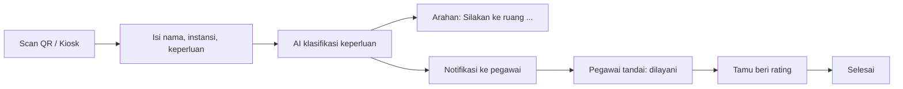
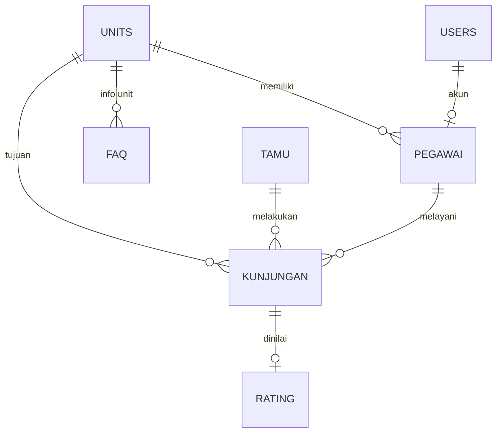

# 📖 Buku Tamu Digital

Buku tamu digital dengan **asisten resepsionis berbasis AI** untuk instansi pelayanan publik. Tamu cukup memindai QR atau memakai tablet kiosk, menulis keperluan dengan kalimat biasa, lalu sistem mengarahkan ke unit/pegawai yang tepat dan memberi tahu pegawai tersebut secara otomatis.

> Dikembangkan oleh satu kelompok yang terdiri dari 6 orang.

**Cocok untuk:** BPS, Perpustakaan Bung Karno, Dinas Pendidikan, Kantor Kecamatan, dan instansi sejenis.

---

## 📑 Daftar Isi

- [Latar Belakang](#-latar-belakang)
- [Fitur](#-fitur)
- [Peran Pengguna](#-peran-pengguna)
- [Alur Pemakaian](#-alur-pemakaian)
- [Peran AI](#-peran-ai)
- [Tech Stack](#-tech-stack)
- [Struktur Database](#-struktur-database)
- [Struktur Folder](#-struktur-folder)
- [Instalasi](#-instalasi)
- [Konfigurasi Environment](#-konfigurasi-environment)
- [Privasi & Keamanan Data](#-privasi--keamanan-data)
- [Roadmap](#-roadmap)
- [Tim Pengembang](#-tim-pengembang)
- [Lisensi](#-lisensi)

---

## 🎯 Latar Belakang

Buku tamu kertas punya beberapa masalah yang berulang:

| Masalah | Dampak |
|---|---|
| Tulisan tangan sulit dibaca | Data tamu tidak bisa dipakai ulang |
| Petugas tidak tahu tamu ingin bertemu siapa | Tamu menunggu lama atau salah ruangan |
| Rekap kunjungan dihitung manual | Memakan waktu dan rawan salah hitung |

**Buku Tamu Digital** menggantikan buku kertas dengan form cepat, klasifikasi keperluan otomatis oleh AI, notifikasi ke pegawai tujuan, dan rekap otomatis untuk pimpinan.

---

## ✨ Fitur

### Fitur Inti
- **Form tamu cepat**: tamu yang pernah datang cukup mengisi nomor HP.
- **Data master**: unit, pegawai, dan jam layanan.
- **Status kunjungan**: `menunggu` → `dilayani` → `selesai`.
- **Rekap harian/bulanan** dengan ekspor dan cetak.
- **Tanda tangan digital** langsung di layar.
- **Rating singkat** sebelum tamu pulang.

### Interaktif & Mudah Dipakai
- Mode **kiosk layar penuh** dengan tombol besar.
- **QR per meja/lokasi** (tamu bisa mengisi dari ponsel sendiri).
- **Notifikasi ke pegawai** via WhatsApp/email.
- Layar **ucapan selamat datang** dan **arahan setelah submit** (contoh: "Silakan ke ruang …").

---

## 👥 Peran Pengguna

| Peran | Akses | Login |
|---|---|---|
| **Tamu** | Mengisi form, melihat arahan, bertanya ke asisten FAQ, memberi rating | ❌ Tidak perlu |
| **Resepsionis / Admin** | Kelola data master & FAQ, koreksi hasil klasifikasi AI, pantau antrean kunjungan | ✅ |
| **Pegawai** | Menerima notifikasi, menandai tamu sudah dilayani | ✅ |
| **Pimpinan** | Melihat rekap dan ringkasan mingguan | ✅ |

---

## 🔄 Alur Pemakaian

1. Tamu memindai **QR di meja depan** atau memakai **tablet mode kiosk**.
2. Tamu mengisi **nama, instansi**, dan menulis **keperluan** dengan kalimat biasa.
3. **AI membaca keperluan**, menentukan unit/pegawai tujuan, lalu menampilkan arahan *"Silakan ke ruang …"*.
4. **Pegawai tujuan** menerima notifikasi dan menandai tamu sudah dilayani.
5. Tamu memberi **rating singkat** sebelum pulang.



---

## 🤖 Peran AI

| Fitur AI | Input | Output |
|---|---|---|
| **Klasifikasi keperluan** | Teks keperluan tamu | Unit tujuan, kategori keperluan, ringkasan satu kalimat. Hasil dapat diubah resepsionis. |
| **Asisten tanya-jawab** | Pertanyaan tamu (jam layanan, letak ruang, syarat layanan) | Jawaban **hanya dari data FAQ** yang diisi admin. |
| **Ringkasan mingguan** | Data kunjungan satu minggu | Ringkasan keperluan paling sering muncul untuk pimpinan. |

**Prinsip penggunaan AI:**
- Hasil klasifikasi selalu bisa dikoreksi manual oleh resepsionis.
- Asisten tanya-jawab dibatasi pada data FAQ; jika jawaban tidak ada, asisten menyarankan bertanya ke petugas.
- Hanya teks keperluan yang dikirim ke layanan AI, tanpa data identitas yang tidak diperlukan.

---

## 🛠 Tech Stack

| Lapisan | Teknologi |
|---|---|
| Backend | [Laravel](https://laravel.com) (PHP) |
| Frontend | [React](https://react.dev) |
| Build tool | [Vite](https://vite.dev) |
| Styling | [Tailwind CSS](https://tailwindcss.com) |
| Database | MySQL / MariaDB |
| Integrasi AI | LLM API melalui HTTP client Laravel (provider dapat dikonfigurasi) |
| Notifikasi | Laravel Mail dan WhatsApp gateway |

> **Catatan versi:** per 21 November 2026, Laravel 13 adalah versi mayor terbaru (rilis 17 Maret 2026) dan membutuhkan **PHP 8.3 atau lebih baru** (sumber: laravel.com). Jika proyek memakai versi Laravel lain, sesuaikan persyaratan PHP di bawah.

> **Library pendukung (rencana, sesuaikan dengan implementasi):** `signature_pad` (tanda tangan digital), library QR code, ekspor Excel/PDF, serta Inertia.js bila React disajikan lewat Laravel.

---

## 🗄 Struktur Database

Tabel utama: `users`, `units`, `pegawai`, `tamu`, `kunjungan`, `faq`, `rating`.



| Tabel | Kolom utama (usulan) |
|---|---|
| `users` | id, name, email, password, role (`admin`, `resepsionis`, `pegawai`, `pimpinan`) |
| `units` | id, nama, ruang, jam_layanan, deskripsi |
| `pegawai` | id, user_id, unit_id, nama, jabatan, no_wa, email |
| `tamu` | id, nama, instansi, no_hp (unik) |
| `kunjungan` | id, tamu_id, unit_id, pegawai_id, keperluan, kategori, ringkasan_ai, status, lokasi_qr, tanda_tangan, waktu_datang, waktu_dilayani, waktu_selesai |
| `faq` | id, unit_id (opsional), pertanyaan, jawaban, aktif |
| `rating` | id, kunjungan_id, nilai (1-5), komentar |

**Catatan desain:** tamu dikenali **hanya dari nomor HP**, sehingga tamu lama cukup mengisi nomor HP dan data lainnya terisi otomatis.

---

## 📂 Struktur Folder

Struktur standar Laravel + React (menyesuaikan implementasi):

```
Buku-Tamu-Digital/
├── app/
│   ├── Http/Controllers/
│   ├── Models/
│   └── Services/          # AI classifier, notifikasi, rekap
├── database/
│   ├── migrations/
│   └── seeders/
├── resources/
│   ├── css/
│   └── js/                # Komponen React (halaman tamu, kiosk, dashboard)
├── routes/
│   └── web.php
├── .env.example
├── vite.config.js
└── README.md
```

---

## 🚀 Instalasi

### Prasyarat
- PHP sesuai versi Laravel yang dipakai (Laravel 13: PHP ≥ 8.3)
- Composer
- Node.js dan npm
- MySQL / MariaDB
- Git

### Langkah

```bash
# 1. Clone repositori
git clone https://github.com/vemaarnandha/Buku-Tamu-Digital.git
cd Buku-Tamu-Digital

# 2. Install dependensi backend & frontend
composer install
npm install

# 3. Siapkan environment
cp .env.example .env
php artisan key:generate

# 4. Atur koneksi database di .env, lalu migrasi
php artisan migrate --seed

# 5. Jalankan aplikasi (dua terminal)
php artisan serve
npm run dev
```

Buka `http://localhost:8000`.

### Build untuk produksi

```bash
npm run build
php artisan config:cache
php artisan route:cache
```

---

## ⚙️ Konfigurasi Environment

Contoh variabel pada `.env` (nama variabel AI/WhatsApp menyesuaikan provider yang dipilih tim):

```env
APP_NAME="Buku Tamu Digital"
APP_URL=http://localhost:8000

DB_CONNECTION=mysql
DB_HOST=127.0.0.1
DB_PORT=3306
DB_DATABASE=buku_tamu
DB_USERNAME=root
DB_PASSWORD=

# AI (klasifikasi, FAQ, ringkasan mingguan)
AI_API_KEY=
AI_MODEL=

# Notifikasi
MAIL_MAILER=smtp
WHATSAPP_API_URL=
WHATSAPP_API_TOKEN=
```

> ⚠️ **Jangan pernah commit file `.env` atau API key ke repositori.**

---

## 🔒 Privasi & Keamanan Data

- **Tidak meminta foto KTP tamu.** Nomor HP saja sudah cukup untuk mengenali tamu yang sama.
- Data yang dikumpulkan seminimal mungkin: nama, instansi, nomor HP, keperluan, tanda tangan digital.
- Halaman tamu tidak memerlukan login, sedangkan dashboard dilindungi autentikasi berbasis peran.
- Rekap untuk pimpinan berupa data agregat.

---

## 🗺 Roadmap

- [ ] Setup proyek (Laravel, Vite, React, Tailwind)
- [ ] Autentikasi dan manajemen peran
- [ ] CRUD unit, pegawai, jam layanan, FAQ
- [ ] Form tamu cepat dan pengenalan tamu via nomor HP
- [ ] Mode kiosk dan QR per lokasi
- [ ] Klasifikasi keperluan oleh AI
- [ ] Notifikasi WhatsApp/email ke pegawai
- [ ] Status kunjungan dan dashboard pegawai
- [ ] Tanda tangan digital dan rating
- [ ] Asisten tanya-jawab (FAQ)
- [ ] Rekap harian/bulanan, ekspor, dan cetak
- [ ] Ringkasan mingguan AI untuk pimpinan

---

## 🤝 Tim Pengembang

| Nama | Peran |
|---|---|
| _Nama anggota 1_ | _Contoh: Project Manager / Backend_ |
| _Nama anggota 2_ | _Contoh: Frontend_ |
| _Nama anggota 3_ | _Contoh: UI/UX_ |
| _Nama anggota 4_ | _Contoh: Database / AI_ |
| _Nama anggota 5_ | _Contoh: QA / Dokumentasi_ |
| _Nama anggota 6_ | _Contoh: Fullstack_ |

### Alur Kontribusi
1. Buat branch dari `main`: `git checkout -b feat/nama-fitur`
2. Commit dengan pesan jelas: `git commit -m "feat: tambah form tamu"`
3. Push dan buat Pull Request untuk di-review anggota lain.

---

## 📄 Lisensi

Proyek ini dibuat untuk keperluan tugas/pembelajaran. Tentukan lisensi (misalnya MIT) sesuai kesepakatan tim.
